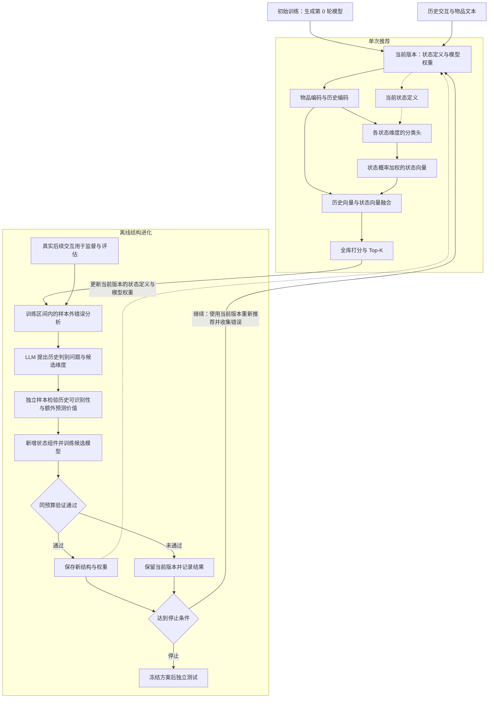

# 基于预测信息缺失的用户状态自进化推荐

当前版本为研究设计 v0.1，整理于 2026-11-12。项目目前包含方案与思路图，模型实现、实验数据处理和性能验证待开展。

## 研究目标

构建一个能够独立完成训练、全库推荐和结构更新的 LLM 推荐框架。系统通过分析自身的预测错误，发现当前用户表示遗漏的语义信息，自动提出、验证并引入新的用户状态维度，目标是在独立测试数据上提高 Recall 和 NDCG。

核心研究假设是，一部分持续出现的推荐错误源于用户表示对不同需求的混淆。LLM 可以从跨用户的历史模式中提出可观察的区分依据。经过样本外检验后，这些依据可能成为具有额外预测价值的状态维度。

该假设以及相对强基线的性能收益均有待实验验证。

## 当前思路图

图中展示从初始训练到最终测试的完整闭环。当前模型根据历史完成推荐，预测记录与真实后续交互共同进入错误分析。LLM 提出候选状态维度，经过检验、训练和同预算验证后，系统决定更新或保留当前版本。若继续进化，使用当前版本重新执行推荐并收集新的错误记录；达到停止条件后，冻结方案进行独立测试。绿色回路连接结构更新与下一轮推荐。

## 自进化的对象

系统维护一组跨用户共享的状态维度定义，每个维度包含名称、状态取值、历史判断依据和不确定状态。各个用户根据自己的历史得到不同的状态概率。

例如，系统起初只表达“关注 Python”。在多位用户上发现持续的预测分歧后，系统可能提出“学习活动类型”，其状态为“基础学习”“项目实践”“不确定”。之后又可能提出“应用领域”，以区分数据分析、Web 开发等情境。

这些例子用于解释机制，最终采用的维度应由训练数据和验证结果决定。

| 变化层面 | 触发条件 | 具体更新 |
| --- | --- | --- |
| 用户当前状态 | 新的历史交互到来 | 重新估计该用户在现有各维度上的状态概率 |
| 状态结构自进化 | 多用户预测错误显示出可泛化的遗漏信息 | 新增、细分、合并或删除共享状态维度，并更新相关模型参数 |

本项目的研究重点是第二种变化。第一版原型先实现新增维度这一种结构操作。

## 模型结构与单次推荐

### 输入

- 交互记录包含用户 ID、物品 ID 和时间戳。
- 物品信息包含标题、类目、简介等可获得的文本。
- 状态定义描述当前版本需要识别的语义维度及其判断依据。

每个训练样本由推荐时刻之前的历史前缀和下一次交互物品组成。状态识别的输入范围限定为历史前缀及当时可用的物品信息。

### 推荐模型

1. **物品编码器**融合物品 ID 和文本特征，得到物品向量。
2. **历史编码器**读取交互顺序及物品向量，得到用户历史向量。
3. **状态分类头**针对每个维度输出状态概率，允许历史证据不足时输出不确定。
4. **状态向量层**按状态概率对可学习的状态向量加权。
5. **融合模块**将历史向量和状态向量组合为最终用户向量。
6. **全库打分模块**计算用户与各物品的匹配分数，输出 Top-K。

原始历史向量持续参与打分，以保留状态维度尚未覆盖的细粒度行为信息。不同状态维度可以同时生效。

可采用如下初始参数化形式。设历史向量为 h，各维度的状态概率为 p_j，对应状态向量矩阵为 E_j，则状态向量为 z_j = p_j E_j。融合模块根据 h 和各 z_j 计算最终用户向量，再与物品向量做匹配。具体融合方式和维度数量通过验证集选择。

### 状态识别训练

LLM 根据状态定义与历史前缀生成带依据的伪标签，分类头学习预测这些标签。标签存在噪声，需要抽样审查、记录不确定情况，并以最终推荐表现检验价值。

训练目标包含下一物品预测损失和状态分类损失。状态向量、融合模块及推荐模型通过真实交互监督优化，两个损失的权重由验证数据确定。

初始版本可以先训练无新增状态维度的基础模型，形成第 0 轮基线。候选维度引入时复用已有权重，先训练新增组件，再进行短程联合训练。对照实验需要匹配训练预算。

## 离线结构进化流程

### 1. 记录预测错误

在训练数据内部按时间滚动，使用只见过更早数据的模型预测后续交互。保存历史前缀、当前状态概率、目标排名、推荐分数以及模型版本。

从中寻找表示或预测分布相近、但后续选择呈现可重复分歧的历史片段。发现过程同时考虑预测正确的样本，检查候选修改对已有能力的影响。

### 2. 形成候选维度

LLM 分析多用户的训练案例，提出能够从历史中回答的判别问题，并给出结构化定义。

| 定义字段 | 内容 |
| --- | --- |
| 维度名称 | 例如“学习活动类型” |
| 状态取值 | 例如“基础学习”“项目实践”“不确定” |
| 判断依据 | 可在历史物品文本、顺序等输入中观察到的证据 |
| 适用范围 | 哪些用户情境具有足够信息 |
| 输出约定 | 状态标签、依据片段及不确定情况 |

发现阶段可以分析训练案例的真实后续交互。为其他样本生成状态标签时，输入只包含候选定义和历史前缀，目标物品单独存放用于评估。

### 3. 检验历史可识别性与额外预测价值

使用未参与候选发现的样本，检查状态定义能否被稳定应用，以及对应状态能否解释当前模型剩余的预测错误。

这一检验使用样本外预测结果，并设置同容量对照，降低以更大模型或更长训练解释收益的可能性。离线收益支持的是预测价值，对用户心理状态的解释需要保持与数据证据一致。

### 4. 构建候选模型

通过初步筛选的维度获得独立分类头和状态向量，接入融合模块。候选模型使用真实交互训练，并与当前版本在相同数据、候选范围和评测设置下比较。

### 5. 接受、保留与下一轮

达到预先确定的性能与复杂度要求后，保存新状态定义、模型权重和评测结果，作为下一轮起点。未通过的候选记录失败原因，当前版本继续保留。

后续轮次基于当前版本的剩余错误发现新维度。维度细分、合并和删除作为后续扩展，每种操作都需要经过同样的验证流程。

## 数据划分与停止条件

| 数据用途 | 允许的操作 |
| --- | --- |
| 基础训练区间 | 训练初始推荐模型和物品表示 |
| 进化发现区间 | 生成样本外错误记录、提出候选维度、训练新增组件 |
| 进化筛选区间 | 选择候选结构、超参数及停止轮次 |
| 最终测试区间 | 对确定后的模型及各轮检查点进行统一评测 |

各区间按全局时间组织，滚动预测时模型只使用预测时刻之前的数据。反复参与筛选的数据属于开发过程，独立测试结果用于衡量最终泛化表现。各基线采用一致的数据访问范围。

停止条件应结合实际数据量提前设定，可以包括连续若干轮无可靠增益、达到状态容量上限或用尽搜索预算。具体提升门槛、耐心轮数和最多轮次属于待验证的超参数。

结构更新同时考虑样本外预测收益和新增状态的复杂度。第一版以 Recall@20 为主选择指标，并同时检查 NDCG@20 和资源开销。连续几轮验证收益不足，只说明本次搜索在当前数据与预算下停止。

## 如何证明结构进化有效

### 主要指标

- 全库 Recall@10、Recall@20、NDCG@10、NDCG@20。
- 各轮状态维度数量、有效触发覆盖率及新增维度的独立贡献。
- LLM 调用量、模型参数量、训练时间和推理开销。

当前框架直接进行全库评分。若后续为规模化引入候选召回阶段，再增加候选 Recall@100，并同时报告最终 Top-K 结果。

### 必须回答的实验问题

| 问题 | 对照设计 |
| --- | --- |
| 新状态是否带来额外信息 | 第 0 轮模型、增加同等参数量的模型、增加随机或聚类状态的模型 |
| LLM 的语义发现是否有价值 | 使用相同预算比较 LLM 判别问题、自动聚类和特征搜索 |
| 多轮进化是否必要 | 一次性生成全部维度、逐轮发现维度，以及相同预算的重复搜索 |
| 收益能否跨用户和时间复现 | 后续时间段与用户分组评估 |
| 收益是否来自额外训练 | 给基础模型相同训练数据和更新预算 |
| 状态是否只增加复杂度 | 维度消融、容量匹配、推理成本比较 |

主要风险是候选维度过拟合、伪标签噪声、状态维度冗余，以及强序列模型已经捕获相关信息。实验需要逐项判断这些因素。

## 最小可行原型

1. 选择一个具有物品文本的公开数据集，明确交互语义和时间戳含义。
2. 建立第 0 轮全库推荐模型和固定评测流程。
3. 从样本外预测错误中提出一个候选状态维度。
4. 使用历史前缀生成伪标签并训练状态分类头。
5. 加入状态向量与融合模块，完成一轮候选训练。
6. 与基础模型继续训练、同参数量模型和聚类状态模型比较。
7. 若独立评测支持收益，再扩展到多轮进化与更多结构操作。

第一阶段的成功条件是，一个自动发现的状态维度能够在一致实验条件下产生可复现的额外推荐收益。

## 代码职责规划

下表是后续实现的职责划分，目前尚未建立对应代码模块。

| 模块 | 职责 |
| --- | --- |
| 数据处理 | 时间切分、历史前缀构造、物品文本处理 |
| 推荐模型 | 物品编码、历史编码、状态分类、融合、全库评分 |
| 状态定义管理 | 定义校验、状态取值顺序、版本管理 |
| LLM 标注与发现 | 发现判别问题、生成历史状态伪标签、记录依据 |
| 进化控制器 | 收集错误、生成候选、训练验证、接受或保留版本 |
| 实验评测 | Recall/NDCG、容量匹配、消融和开销记录 |
| 检查点管理 | 联合保存状态定义、权重、物品编码和评测记录 |

## 创新性边界与相邻工作

截至 2026-11-12 的本轮检索，尚未发现完整重合的推荐方法。该判断有检索范围限制，创新性仍需随着文献阅读与实验推进持续核对。

拟研究的具体贡献是，通过多用户预测分歧发现候选语义维度，再以历史可识别性和样本外额外预测收益控制用户状态结构的扩展。自动拆分状态、LLM 状态抽象和反馈驱动画像更新都有已有研究基础。

| 工作 | 已有基础与需要区分的研究范围 |
| --- | --- |
| CSSR | 已研究根据预测分布学习状态结构，自动状态拆分本身已有先例。[作者项目页](https://www.bactra.org/CSSR/) |
| TADT-CSA | 已在推荐中学习状态量化表示，需比较我们的结构扩展与其状态表示学习。[论文](https://arxiv.org/html/2507.20327v1) |
| LARMI | 已用 LLM 做自适应兴趣粒度建模，需验证基于剩余预测错误的结构发现是否有额外贡献。[论文](https://aclanthology.org/2026.findings-acl.117/) |
| RECAP | 已根据推荐反馈优化流式语义画像，本项目关注跨用户共享的状态维度定义如何演化。[论文](https://arxiv.org/html/2607.15730v1) |
| LGA | 已使用语言模型设计状态抽象，LLM 参与状态设计本身已有先例。[论文](https://arxiv.org/html/2402.18759v2) |

## 图的 Mermaid 源码

