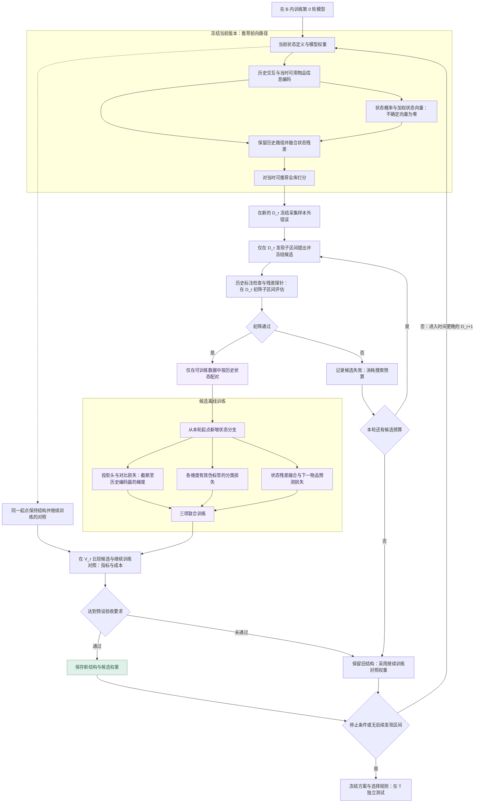

# 基于预测信息缺失的用户状态自进化推荐

当前版本为研究设计 v0.2，更新于 2026-11-12。本版在候选状态分支训练中加入对比学习，并明确多轮时间协议与对照实验约束。项目目前包含研究方案与 Mermaid 流程图，模型实现、实验数据处理和性能验证待开展。

## v0.2 更新

- 保留“样本外错误分析 → 候选状态发现 → 检验 → 候选训练 → 同预算验收 → 下一轮”的结构进化闭环。
- 根据候选维度的历史证据构造同状态正样本与异状态难负样本，跳过状态不确定的片段。
- 在新增状态分支的中间表示上加入对比约束，与状态分类、下一物品预测联合训练。
- 明确对比学习的梯度范围、训练与推理的区别，以及用于分离状态发现和对比学习贡献的消融实验。
- 审查修订：采用向前分轮的时间协议，补全初筛探针、不确定标签及残差初始化；候选与继续训练对照比较，独立初始化对比学习消融组。

以上均为待实现、待验证的设计，不代表已经获得性能提升。

## 研究目标

构建一个由 LLM 辅助发现状态维度、由推荐模型完成全库打分、由离线控制器管理训练和结构更新的推荐框架。系统通过分析自身的预测错误，发现当前用户表示遗漏的语义信息，自动提出、验证并引入新的用户状态维度，目标是在独立测试数据上提高 Recall 和 NDCG。

核心研究假设是，一部分持续出现的推荐错误源于用户表示对不同需求的混淆。LLM 可以从跨用户的历史模式中提出可观察的区分依据。经过样本外检验后，这些依据可能成为具有额外预测价值的状态维度。

该假设以及相对强基线的性能收益均有待实验验证。状态来自已有历史与物品文本，并不自动构成新的用户观测信息；预期作用是借助 LLM 的语义知识和辅助监督，使已有输入中的有效差异更容易被模型学习。

## 当前思路图

完整流程见文末的 [v0.2 Mermaid 流程图](#v02-mermaid-流程图)，可在 GitHub 直接查看。

图中展示从初始训练到最终测试的完整闭环。当前模型根据历史完成推荐，预测记录与真实后续交互共同进入错误分析。LLM 提出候选状态维度，经过初筛、对比样本构造、候选训练和同预算验证后，系统决定更新或保留当前版本。若继续进化，在时间上更晚且未用于拟合的发现区间使用当前版本执行推荐，收集新的错误记录；达到停止条件后，冻结方案进行独立测试。继续进化的回路连接当前版本与下一轮推荐。

## 自进化的对象

系统维护一组跨用户共享的状态维度定义，每个维度包含名称、状态取值、历史判断依据和不确定状态。初始实现约定，同一维度内的已知状态互斥，使用单一 Softmax；可以同时成立的语义应拆成不同维度，多标签分类留待后续研究。各个用户根据自己的历史得到不同的状态概率。

例如，无显式状态分支的初始模型可能只能隐式捕获“关注 Python”。在多位用户上发现持续的预测分歧后，系统可能提出“学习活动类型”，其状态为“基础学习”“项目实践”“不确定”，判断的是当前主导活动；混合活动且无法确定主导时归入“不确定”。之后又可能提出“应用领域”，以区分数据分析、Web 开发等情境。

这些例子用于解释机制，最终采用的维度应由训练数据和验证结果决定。

| 变化层面 | 触发条件 | 具体更新 |
| --- | --- | --- |
| 用户当前状态 | 新的历史交互到来 | 重新估计该用户在现有各维度上的状态概率 |
| 状态结构自进化 | 多用户预测错误显示出可泛化的遗漏信息 | 新增、细分、合并或删除共享状态维度，并更新相关模型参数 |

本项目的研究重点是第二种变化。第一版原型先实现新增维度这一种结构操作。

## 模型结构与单次推荐

### 输入

- 交互记录包含用户 ID、物品 ID 和时间戳。
- 物品信息包含标题、类目、简介等可获得的文本。
- 状态定义描述当前版本需要识别的语义维度及其判断依据。

每个训练样本由推荐时刻之前的历史前缀和下一次交互物品组成。状态识别的输入范围限定为历史前缀及当时可用的物品信息。物品文本也需要遵守时间边界；若只有最终抓取的静态文本，必须披露无法排除文本更新带来的回溯偏差。

“全库”指该预测时刻已可推荐的物品集合，不包含未来才出现的物品。若数据没有上架时间，需预先约定可用性代理（例如首次出现时间）并报告其局限。对当时可推荐但训练中未见的物品，采用共享未知 ID 表示与可用文本编码，不使用未来交互训练其 ID 向量。是否过滤已交互物品应依据任务是否允许重复消费确定，并在所有对照中一致；不能过滤掉合法的测试目标。

### 推荐模型

1. **物品编码器**融合物品 ID 和文本特征，得到物品向量。
2. **历史编码器**读取交互顺序及物品向量，得到用户历史向量。
3. **状态分支与分类头**针对每个维度先计算中间表示，再输出状态概率，允许历史证据不足时输出不确定。
4. **状态向量层**按状态概率对可学习的状态向量加权。
5. **融合模块**将历史向量和状态向量组合为最终用户向量。
6. **全库打分模块**计算用户与各物品的匹配分数，输出 Top-K。

原始历史向量持续参与打分，以保留状态维度尚未覆盖的细粒度行为信息。不同状态维度可以同时生效。

可采用如下初始参数化形式。设历史向量为 h，维度 j 有 K_j 个已知状态及一个“不确定”状态 u，分类概率为 p_j。不确定状态的向量固定为零，状态向量为 z_j = sum_{k=1}^{K_j} p_{j,k} E_{j,k}，不对已知状态概率重新归一化。当不确定概率升高时，该维度的贡献相应减弱，原始历史路径仍可完成推荐。

为保留当前版本的推荐能力，初始融合采用残差扩展：u_new = u_current + alpha_j A_j z_j（此处 u_current、u_new 表示用户向量，与不确定类别的记号无关），各向量保持同一打分维度，再与物品向量匹配。alpha_j 初始化为零、A_j 非零初始化，使新增分支在确定性推理下初始不改变旧模型分数。alpha_j、A_j 与状态向量在候选训练时可学习；状态分类和对比损失可在残差尚未生效时预训练分支。需记录 alpha_j 与分支消融结果，不能仅凭状态分类准确率认定推荐模型实际使用了该维度。具体容量与融合变体通过开发数据选择。

### 状态识别与对比学习

LLM 根据状态定义与历史前缀生成带依据的伪标签，分类头学习预测这些标签。标签存在噪声，需要抽样审查、记录不确定情况，并以最终推荐表现检验价值。真实下一物品用于推荐监督与错误分析，不输入状态标注器，也不用于直接判定正负样本的状态。

区分两类情况：历史确实证据不足时输出“不确定”，将其作为显式分类标签；标注格式错误、无法核验依据或证据冲突时标为无效，跳过状态分类和对比监督。两类样本仍可参与下一物品预测训练。“不确定”样本不参与对比配对。LLM 自报置信度不视为已校准概率，标注质量需通过重复标注一致性或独立抽样审查检查。

对维度 j，令历史编码为 h，状态分支中间表示为 r_j = f_j(h)，分类概率为 p_j = softmax(W_j r_j + b_j)。对比学习使用 r_j 经训练用投影头 g_j 得到的归一化向量 q_j；这里的“Softmax 前表示”指分类头之前的隐向量 r_j，不是分类 logits 或最终用户融合向量。

推理时只计算历史编码、状态概率、加权状态向量、融合和全库打分。LLM 候选发现、伪标签生成、对比样本构造及投影头仅用于离线训练，不需要在每次推荐时运行。

### 按候选维度构造对比样本

在候选定义通过初筛后，固定定义，在允许用于训练的历史前缀上标注状态与依据。错排片段用于寻找难例，同时保留普通样本与预测正确样本，避免训练只覆盖错误案例。

| 样本类型 | 构造依据 |
| --- | --- |
| 锚点 | 在当前候选维度上有明确历史证据的片段 |
| 正样本 | 在同一维度上有证据支持相同状态的另一片段，可来自不同用户 |
| 难负样本 | 主题相似、旧模型容易混淆，但历史证据支持该维度不同状态的片段 |
| 跳过的样本 | 状态不确定、证据冲突或标注质量不足的片段；不作为正负配对依据 |

配对按维度独立进行：在“学习活动类型”上同属项目实践，不要求两人在应用领域等其他维度也相同。不因点击同一个下一物品而直接判为同状态，也不因下一物品不同而直接判为异状态。初始原型采用跨用户配对，每个对比批次同一用户至多保留一个历史前缀，避免依靠用户身份或重复内容完成对比任务。记录各状态覆盖率、标注质量和配对数量；该约束不意味着已完成跨用户泛化评测。

正负关系由同一维度的标签确定。初始实现可用按状态分层的小批次采样，保证有效锚点至少有一个非自身正样本及一个异状态负样本。难负样本先从冻结的当前模型表示或文本相似度中检索，再按历史状态证据过滤；不将全部其他样本默认视为负样本，避免把同状态样本误当负例。检索规则、频次与每状态配额提前设定，记录采样带来的额外开销。

### 三项联合训练目标

候选模型采用下一物品预测、状态分类和对比学习三项损失：

```math
\mathcal{L} = \mathcal{L}_{\mathrm{rec}}
+ \lambda_{\mathrm{state}} \mathcal{L}_{\mathrm{state}}
+ \lambda_{\mathrm{con}} \mathcal{L}_{\mathrm{con}}.
```

- **下一物品预测损失**：用真实后续交互训练融合后的推荐模型，具体损失形式由基础推荐模型确定。
- **状态分类损失**：对有效伪标签使用包含“不确定”类的交叉熵；无效标注掩码跳过。类别权重仅由训练数据估计，策略通过开发数据选择。
- **对比损失**：在新增维度的 q_j 上拉近同状态样本、区分异状态难例。初始原型可采用监督式对比损失，温度、正负采样比例与权重由验证集选择；没有有效正样本或异状态负样本的锚点跳过该项。若本轮没有足够可配对样本，记录对比训练不可用，不能将零有效锚点的运行当作已验证对比学习。

初始对比目标定义为：对有效锚点 i，P(i) 为采样批次中同状态的非自身样本，A(i) 为全部其他有效已知状态样本，且包含异状态负样本。以单位化投影向量的内积为相似度，温度 tau > 0：

```math
\mathcal{L}_{\mathrm{con}} = \frac{1}{|I|}\sum_{i\in I}
\frac{-1}{|P(i)|}\sum_{p\in P(i)}
\log\frac{\exp(q_i^\top q_p/\tau)}
{\sum_{a\in A(i)}\exp(q_i^\top q_a/\tau)}.
```

I 只包含同时具有正负样本的锚点；I 为空时跳过该批次的对比项并记录计数。三项损失分别对各自有效样本取均值，状态分类先在各维度内平均、再对有有效标签的维度平均，然后加权相加；没有有效标签时跳过分类项。这可以减少标注覆盖率或维度数量变化引起的损失尺度漂移。初始候选训练每次只新增一个维度；后续轮次的状态分类损失覆盖全部已有维度（沿用冻结的定义及对应有效伪标签），对比损失只覆盖本轮新增维度。

对比约束只针对本轮新增维度的表示，不直接约束旧状态分支、完整历史向量或最终用户向量。这减少了直接压缩完整用户表示的约束，但共享参数和联合训练仍可能改变其他偏好信息，是否有效需通过消融验证。

### 初始化、训练阶段与梯度范围

第 0 轮先训练无新增状态维度的基础模型。引入候选维度时复用当前版本权重，新增状态分支、分类头、状态向量和训练用投影头；融合模块按需要扩展并保留可复用权重。

1. **新增组件预训练**：冻结已有组件，先训练新增状态相关组件及融合模块新增参数。
2. **短程联合训练**：更新推荐主干、已有状态分支、融合模块与新增组件；已有维度的定义与标签含义保持不变。推荐损失作用于完整推荐路径，状态分类损失监督各维度；对照模型获得相同数据和可比更新预算。
3. **对比梯度隔离**：初始实现约定，对比路径使用 f_j(stop_gradient(h))，再接投影头。对比损失更新新增状态分支与投影头，不沿该路径回传到共享历史编码器；推荐与状态分类路径仍使用未截断的 h。旧状态分支不接收直接的对比梯度，其输出仍可能随共享编码器的其他更新改变。

该约定使“对比损失仅作用于新增状态分支”具有明确含义。是否允许对比梯度更新共享编码器作为后续消融项，不预设其收益。预训练时长、联合训练时长及各损失权重属于待验证的超参数。

## 离线结构进化流程

### 1. 记录预测错误

按下文的分轮时间协议，在本轮尚未用于拟合的发现区间使用冻结的当前版本预测后续交互。保存历史前缀、当时可推荐物品集合、当前状态概率、目标排名、推荐分数、模型与状态定义版本及其数据截止时间。

同一区间按时间扫描时，用户历史可加入扫描时刻之前已发生的交互，但本轮采集期间不更新模型参数、候选定义或其他数据拟合的组件。不能用已在整段区间训练过的当前权重重新预测该区间，再将结果称为样本外预测。

从中寻找表示或预测分布相近、但后续选择呈现可重复分歧的历史片段。发现过程同时考虑预测正确的样本，检查候选修改对已有能力的影响。

### 2. 形成候选维度

LLM 分析多用户的训练案例，提出能够从历史中回答的判别问题，并给出结构化定义。

| 定义字段 | 内容 |
| --- | --- |
| 维度名称 | 例如“学习活动类型” |
| 状态取值 | 例如“基础学习”“项目实践”“不确定” |
| 判断依据 | 可在历史物品文本、顺序等输入中观察到的证据 |
| 适用范围 | 哪些用户情境具有足够信息 |
| 输出约定 | 状态标签、依据片段及不确定情况 |

发现阶段只分析本轮候选发现子区间内的真实后续交互。定义冻结后，为初筛子区间和其他样本生成状态标签时，输入只包含候选定义和历史前缀；目标物品单独存放，供推荐训练、探针评估或最终模型评测使用。

候选需满足可操作的历史判别依据与最小覆盖率，并与已有维度比较冗余。没有足够历史证据的错误可能来自随机选择、曝光或物品表示不足，应允许“本轮没有可用新维度”，不强行解释为用户状态缺失。

### 3. 检验历史可识别性与额外预测价值

初筛与完整候选训练分开，不能在模型尚未构建时直接宣称获得最终推荐收益：

1. 在本轮候选发现子区间检查标签覆盖率、状态分布、标注一致性和与已有维度的冗余，冻结候选定义及初筛阈值。
2. 以冻结的当前模型为基础，在候选发现子区间训练一个低成本残差预测探针，将历史状态标签的独热编码接入打分（不确定标签映射为零状态向量）；同时训练不接状态、但增加相当参数量的探针对照。
3. 在时间上更晚的初筛子区间评估。该区间的标签仅由历史生成，后续交互只用于衡量预测效果。比较探针是否带来增量预测信号，并审查状态能否稳定识别。

这里可以使用离线 LLM 状态标注作为探针输入，因此初筛仅说明值得训练候选分支，不等于在线分类头已能复现该信息，也不保证完整模型改善。探针选择数据属于开发数据；反复用于修改候选后不再具有独立确认作用。所有候选尝试均计入搜索预算。最终验收仍由完整候选模型在本轮筛选区间的推荐效果决定。离线结果不用于证明真实心理状态或因果关系。

### 4. 构建候选模型

通过初步筛选的维度获得独立状态分支、分类头、状态向量和训练用投影头。根据该维度的历史证据构造对比样本，将新增状态向量接入融合模块，按上述三项损失训练候选模型。

候选模型与当前版本在相同数据、可推荐物品范围和评测设置下比较。对比损失下降或状态分类更准确不能单独作为接受依据，必须检验最终推荐收益及复杂度。

### 5. 接受、保留与下一轮

先从同一轮起点复制当前版本，得到“保持结构并继续训练”的对照版本；它与候选版本使用相同可训练数据和预先约定的更新预算。候选必须超过这一继续训练对照，而非只超过训练较少的旧检查点。

达到预先确定的性能与复杂度要求后，保存新状态定义、模型权重和评测结果。候选未通过时记录失败原因，保留原状态结构并采用对应继续训练对照的权重作为下一轮版本；“保留结构”不要求权重停留在旧数据截止时间。每个候选独立从本轮起点初始化，不串行继承其他候选的试验权重。

后续轮次基于当前版本的剩余错误发现新维度。维度细分、合并和删除作为后续扩展，每种操作都需要经过同样的验证流程。

## 数据划分与停止条件

### 分轮时间协议

为避免多轮更新后重新回看旧数据造成泄漏，初始原型采用严格向前的分轮区间。预先按全局时间固定：

```text
B → D_1 → V_1 → D_2 → V_2 → ... → D_R → V_R → T
```

| 数据用途 | 允许的操作 |
| --- | --- |
| B：基础训练区间 | 训练第 0 轮模型；基础超参数在 B 内部的时间验证划分选择 |
| D_r：第 r 轮发现与训练区间 | 先用本轮起点的冻结版本采集样本外错误，再进行候选发现、初筛及候选训练 |
| V_r：第 r 轮筛选区间 | 比较完整候选与继续训练对照，选择结构和开发超参数；不作为训练目标样本、状态标注/配对样本或 LLM 候选发现案例 |
| T：最终测试区间 | 方案和全部选择规则冻结后统一评测，不再根据结果修改方法 |

D_r 再按时间分为候选发现子区间与初筛子区间。候选只在前者提出，预测探针也只在前者拟合，在后者初筛。初筛完成后，两部分都可以用于完整候选训练，因此初筛结果属于开发结果，不能再作为最终泛化证据。

第 r 轮采集错误时，当前结构、权重、文本编码器、归一化统计及其他拟合组件只能依赖 D_r 之前的数据。完成错误采集与候选冻结后，候选及继续训练对照可使用 B 与 D_1 至 D_r 的训练数据；各 V 区间的目标样本始终不进入训练或对比配对池。预测时刻早于 D_r 的 V 区间交互，可以作为 D_r 样本的已发生历史输入；这与把 V 的目标作为训练监督不同，所有对照采用相同规则。V_r 的选择结果可以影响下一轮结构，但 D_{r+1} 必须在 V_r 之后，因此仍是向前预测。

继续进化意味着进入新的 D_{r+1}，不能把在 D_r 上训练后的权重用于重新生成 D_r 的“样本外错误”。没有足够后续区间时停止；如改用时间交叉拟合，必须对每个折重新训练权重，并确保状态定义及所有拟合组件也不依赖该折之后的信息，不能只重训分类头。

每个 V_r 可以在预设的小规模搜索预算内被重复访问，但结果属于自适应开发评估，不能称为无偏确认。独立 T 用于报告最终泛化。多轮切分可能导致每轮样本过少，首个原型优先验证单轮；所有基线遵守一致的数据可用性和时间边界。

### 停止与验收

提前设定候选尝试数、每轮训练与 LLM 预算、状态容量上限及最多轮次。以全库 Recall@20 为主选择指标，要求候选相对本轮继续训练对照达到预设最小增益，同时满足 NDCG@20 退化容限和资源上限。具体数值在最终测试前确定，不在看到测试结果后调整。

连续若干轮无合格候选、无足够配对样本、达到容量或预算上限、用尽后续发现区间均可触发停止。连续无增益只说明本次搜索在当前数据与预算下停止。最终测试允许比较预先登记的各轮检查点，但不得再以 T 选择轮次；应披露早期检查点可见训练数据更少，各轮曲线不能单独证明结构进化优于额外训练。

## 如何证明结构进化有效

### 主要指标

- 全库 Recall@10、Recall@20、NDCG@10、NDCG@20。
- 各轮状态维度数量、有效触发覆盖率及新增维度的独立贡献。
- LLM 调用量、模型参数量、训练时间和推理开销；单独记录离线配对与投影头的训练开销。
- 伪标签有效覆盖率、正负样本覆盖率及各状态样本分布，作为训练诊断指标，不替代推荐指标。

单目标的下一物品任务中，Recall@K 等价于 Hit Rate@K；需明确指标实现。用户历史在测试时可随已发生的交互更新，但模型参数与状态定义冻结，所有方法采用相同规则。

当前框架直接进行全库评分。若后续为规模化引入候选召回阶段，再增加候选 Recall@100，并同时报告最终 Top-K 结果。

### 必须回答的实验问题

| 问题 | 对照设计 |
| --- | --- |
| 新状态是否带来额外信息 | 第 0 轮模型、增加同等参数量的模型、增加随机或聚类状态的模型 |
| LLM 的语义发现是否有价值 | 使用相同预算比较 LLM 判别问题、自动聚类和特征搜索 |
| 多轮进化是否必要 | 一次性生成全部维度、逐轮发现维度，以及相同预算的重复搜索 |
| 收益能否跨用户和时间复现 | 后续时间段与用户分组评估；若声称跨用户泛化，另设未参与候选发现与训练的用户组 |
| 收益是否来自额外训练 | 给基础模型相同训练数据和更新预算 |
| 状态是否只增加复杂度 | 维度消融、容量匹配、推理成本比较 |
| 对比学习是否带来独立收益 | 固定同一候选维度与伪标签，比较状态分支有无对比损失，并匹配更新预算 |
| 难负样本构造是否必要 | 在同一状态分支上比较随机异状态负样本与主题相近的异状态难负样本 |
| 收益是否来自通用对比训练 | 给基础模型加入通用对比目标，在可比训练和搜索预算下比较 |
| 对比梯度隔离是否合理 | 比较截断与允许对比梯度进入历史编码器，检查推荐收益及旧能力变化 |

主要风险是候选维度过拟合、伪标签噪声、状态维度冗余，以及强序列模型已经捕获相关信息。对比学习还可能放大错误标签，将实际同状态的片段当作负样本，或过度压缩同状态用户的其他差异。实验需要逐项判断这些因素。

对比学习消融必须从相同轮起点、相同候选定义与标签分别训练“无对比”和“有对比”两组；不能先训练无对比版本，再只给对比组额外训练。新增状态分支预训练也计入更新预算。优先匹配数据访问、优化步数与批次大小，并同时报告训练时间、参数量及 LLM/探针搜索成本；这些成本不能假定同时完全相等。需要时补充相同总计算预算的比较。

最终复现采用事先固定的运行与统计方案。固定已发现结构的多种子运行只检验训练稳定性；若要宣称自动发现过程稳定，还需在可行预算内独立重复候选发现与筛选。

基线应包含使用相同物品文本且训练充分的强序列模型。记录候选尝试次数、LLM 标注与搜索预算，采用多个随机种子报告均值、波动和配对比较；不能只报告筛选后最优的一次运行。最终测试不再用于修改维度、配对策略或超参数。

## 最小可行原型

1. 选择一个具有物品文本的公开数据集，明确交互语义和时间戳含义。
2. 建立第 0 轮全库推荐模型和固定评测流程。
3. 从样本外预测错误中提出一个候选状态维度。
4. 使用历史前缀生成伪标签，在发现子区间训练预测探针、在初筛子区间检验；此时不预先训练完整候选分类头。
5. 固定候选定义与标签，从相同轮起点分别初始化无对比、有对比、同容量及继续训练对照。
6. 构造正样本和难负样本，在匹配预算下分别训练；检查残差初始化、有效配对数和对比梯度作用范围。
7. 与基础模型继续训练、同参数量模型、聚类状态模型和不含对比学习的状态模型比较。
8. 先依据开发评估决定是否扩展多轮；本轮方案冻结后再进行独立测试。若后续根据测试结论改进方法，需要新的独立测试数据，不能继续用原测试集确认改进。

第一阶段的成功条件是，一个自动发现的状态维度能够在一致实验条件下产生可复现的额外推荐收益，并单独判断对比学习是否进一步改善结果。若对比学习无增益，不能据此直接否定状态发现机制；若仅对比学习有效，也不能据此宣称结构进化有效。

## 代码职责规划

下表是后续实现的职责划分，目前尚未建立对应代码模块。

| 模块 | 职责 |
| --- | --- |
| 数据处理 | 时间切分、历史前缀构造、物品文本处理 |
| 推荐模型 | 物品编码、历史编码、状态分支、状态分类、融合、全库评分 |
| 对比训练 | 按维度配对、难负样本挖掘、投影头、损失计算与梯度隔离 |
| 状态定义管理 | 定义校验、状态取值顺序、版本管理 |
| LLM 标注与发现 | 发现判别问题、生成历史状态伪标签、记录依据 |
| 进化控制器 | 收集错误、生成候选、训练验证、接受或保留版本 |
| 实验评测 | Recall/NDCG、容量匹配、消融和开销记录 |
| 检查点管理 | 联合保存状态定义、权重、物品编码和评测记录；恢复训练时保留投影头、优化器及采样配置 |

## 创新性边界与相邻工作

本仓库尚未保存可核验的系统文献检索记录，因此不据此宣称“尚无重合方法”或方法具有首创性。下表保留原方案中的待核查线索，论文身份、版本、内容与本方案的关系均需核对原文；当前不将这些描述作为已验证的相关工作结论。

拟研究的具体贡献是，通过多用户预测分歧发现候选语义维度，再以历史可识别性和样本外额外预测收益控制用户状态结构的扩展。v0.2 的对比学习是候选状态表示的训练机制，加入对比损失本身不构成新的创新性结论，需要通过与已有对比推荐方法的比较确认其作用。还需系统比较预测状态学习、LLM 状态抽象、反馈驱动画像更新与监督式对比推荐。

| 原方案中的线索（待核查） | 待核查的问题与原始链接 |
| --- | --- |
| CSSR | 预测分布驱动的状态结构学习与本方案的关系。[项目页](https://www.bactra.org/CSSR/) |
| TADT-CSA | 状态量化表示与结构扩展的区别。[原方案链接](https://arxiv.org/html/2507.20327v1) |
| LARMI | 兴趣粒度建模与剩余错误驱动发现的区别。[原方案链接](https://aclanthology.org/2026.findings-acl.117/) |
| RECAP | 反馈驱动画像更新与共享状态维度演化的区别。[原方案链接](https://arxiv.org/html/2607.15730v1) |
| LGA | 语言模型辅助状态抽象与本方案的关系。[原方案链接](https://arxiv.org/html/2402.18759v2) |

## v0.2 Mermaid 流程图



图为控制与数据依赖示意，非逐张量计算图。紫色表示候选训练过程；新增状态分支与融合组件本身在接受后也参与推荐推理，只有配对、投影头及训练损失无需在线运行。真实后续交互用于错误分析、探针评估及推荐监督，状态标注和配对仅读取历史前缀。每轮继续训练对照都必须执行，即使没有候选通过初筛；它不使用 V_r 的目标样本进行梯度训练。下一轮只进入更晚的区间，不回看已拟合区间生成样本外错误。
